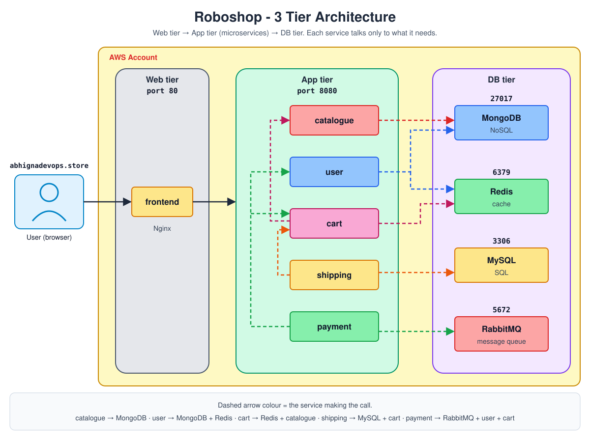
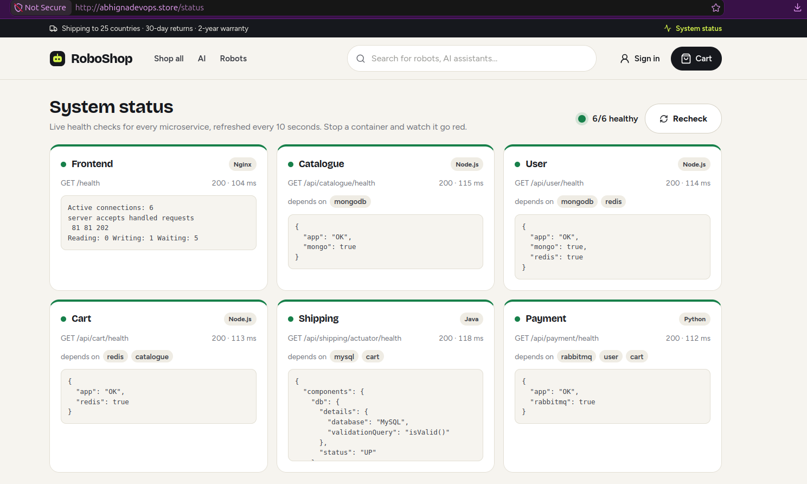

# RoboShop on AWS - Microservices E-Commerce Deployment

An online robot store (**RoboShop**) deployed on AWS as **11 services on 11 EC2 instances**: 4 data services, 6 backend microservices in 4 languages, and an Nginx frontend, all connected by DNS names on my own domain.

I deployed the entire stack **manually, by design**: package installs, configuration, builds, systemd services, security groups, DNS and service-to-service networking. This repo documents every step, the problems I hit, and how I fixed them, as the baseline for automating the same deployment later.



## Table of Contents

1. [What RoboShop Is](#what-roboshop-is)
2. [Tech Stack](#tech-stack)
3. [What I Did](#what-i-did)
4. [How It Fits Together](#how-it-fits-together)
5. [Results](#results)
6. [Problems I Fixed](#problems-i-fixed)
7. [Repo Structure](#repo-structure)
8. [Setup Guide (step by step)](#setup-guide-step-by-step)
9. [Why Manual First, and What's Next](#why-manual-first-and-whats-next)

---

## What RoboShop Is

A full e-commerce flow, split into independent services:

| Customer action | Service | Stores data in |
|-----------------|---------|----------------|
| Browse products | catalogue | MongoDB |
| Register / log in, order history | user | MongoDB + Redis |
| Add to cart | cart | Redis |
| Shipping cost by city | shipping | MySQL |
| Pay | payment | → RabbitMQ |
| Ship the order | dispatch | ← RabbitMQ |
| Website + API gateway | frontend (Nginx) | - |

---

## Tech Stack

| Server | Technology | Version | Port |
|--------|------------|---------|------|
| frontend | Nginx (reverse proxy) + React static site | 1.26 | 80 |
| catalogue | Node.js | 24 | 8080 |
| user | Node.js | 24 | 8080 |
| cart | Node.js | 24 | 8080 |
| shipping | Java (Spring Boot), built with Maven | Java 25, Maven 3.9 | 8080 |
| payment | Python + gunicorn | 3.14 | 8080 |
| dispatch | Go (queue consumer, no port) | 1.26 | - |
| mongodb | MongoDB | 7.0 | 27017 |
| redis | Redis | 7 | 6379 |
| mysql | MySQL | 8.4 | 3306 |
| rabbitmq | RabbitMQ | 4.3 | 5672 |

**AWS:** EC2 (11 × t3.micro, RHEL 9), Security Groups, Route 53, Service Quotas.

---

## What I Did

| # | Step | How |
|---|------|-----|
| 1 | **Capacity** | 11 × t3.micro = 22 vCPUs, above the default 16 → requested 32 On-Demand vCPUs in Service Quotas (approved the same day) |
| 2 | **Security groups** | 11 SGs, one per server, with SG-to-SG rules: each database accepts traffic only from the services that use it, port 80 open only on the frontend, SSH only from my IP |
| 3 | **Servers** | 11 EC2 instances (RHEL 9 AMI), some from the console and the rest with the AWS CLI |
| 4 | **Databases first** | MongoDB, Redis, MySQL, RabbitMQ: install, open the listen address, set users/passwords, verify the port |
| 5 | **DNS** | One Route 53 A record per server with its **private IP** (TTL 30), e.g. `mongodb.<my-domain>`. Every config uses names, not IPs |
| 6 | **Backend services** | For each: runtime → non-root `roboshop` user → download the code → install dependencies / build → **systemd service** with the DB/service addresses in environment variables → verify `/health` |
| 7 | **Data** | 11 products into MongoDB, 948,833 cities into MySQL, a least-privilege MySQL user for shipping (only the `cities` database) |
| 8 | **Frontend** | Nginx serves the website and reverse-proxies `/api/<service>/` to each service by DNS name |
| 9 | **Domain** | Root A record → frontend public IP, `www` CNAME → root |
| 10 | **Testing** | Real orders end to end, a live status page, and a resilience test (below) |
| 11 | **Cleanup** | All 11 instances terminated after the project |

---

## How It Fits Together


```text
Browser → <my-domain> → Nginx (frontend)
                          ├─ /api/catalogue/ → catalogue → MongoDB
                          ├─ /api/user/      → user      → MongoDB + Redis
                          ├─ /api/cart/      → cart      → Redis + catalogue
                          ├─ /api/shipping/  → shipping  → MySQL + cart
                          └─ /api/payment/   → payment   → cart + user + RabbitMQ → dispatch
```

- **Service discovery:** every service finds the others through Route 53 names. An IP change = one DNS update, not edits on every server.
- **Security:** SGs allow only the arrows above. Databases are never open to the internet.
- **Runtime:** every app runs as a `systemd` service under a non-root, no-login user, restarts on failure and starts at boot.
- **Tracing:** Nginx gives each request an `X-Request-Id` that every service logs, so one click can be followed across all servers with `journalctl | grep <id>`.

---

## Results

| Check | Result |
|-------|--------|
| Health of all services | **6/6 healthy** on the live status page |
| Catalogue | 11 products served from MongoDB |
| Shipping | 948,833 cities loaded, cost calculated by distance |
| End-to-end orders | Real orders placed on my own domain: cart → shipping → payment → dispatch |
| Resilience test | Stopped dispatch, placed an order: payment still succeeded, the order **waited in RabbitMQ**, and dispatch consumed it the moment it was back. **Zero orders lost** |



Full run with screenshots, server by server: **[docs/hands-on](docs/hands-on/README.md)**

---

## Problems I Fixed

| Problem | Cause | Fix |
|---------|-------|-----|
| user `/health` → `"redis": false`, log `Socket closed unexpectedly` | Redis `protected-mode yes` with no password set: it accepted the connection, then closed it. SG, DNS and the port were all fine | `protected-mode no` (the SG still restricts access) → restart Redis and user |

**Takeaway:** a timeout points to the network; a connection that opens and then closes points to the application.

Details: **[docs/troubleshooting.md](docs/troubleshooting.md)**

---

## Repo Structure

```text
roboshop-aws-microservices/
├── README.md                ← you are here (project overview)
└── docs/
    ├── README.md            ← setup guide: services, ports, setup order, SG rules, EC2 launch
    ├── 01-mongodb.md … 04-rabbitmq.md     ← databases
    ├── 05-catalogue.md … 10-dispatch.md   ← backend services
    ├── 11-frontend.md       ← Nginx + reverse proxy
    ├── troubleshooting.md   ← problems I faced and how I fixed them
    ├── hands-on/            ← my lab run with 91 screenshots
    └── images/              ← architecture diagrams
```

---

## Setup Guide (step by step)

Start with **[docs/README.md](docs/README.md)** (services, security group rules, EC2 launch), then follow the order:

| Order | Doc |
|-------|-----|
| **Databases** | [01 MongoDB](docs/01-mongodb.md) · [02 Redis](docs/02-redis.md) · [03 MySQL](docs/03-mysql.md) · [04 RabbitMQ](docs/04-rabbitmq.md) |
| **Backend** | [05 Catalogue](docs/05-catalogue.md) · [06 User](docs/06-user.md) · [07 Cart](docs/07-cart.md) · [08 Shipping](docs/08-shipping.md) · [09 Payment](docs/09-payment.md) · [10 Dispatch](docs/10-dispatch.md) |
| **Frontend** | [11 Frontend](docs/11-frontend.md) |

Databases first, then the services that use them, then the frontend: each layer needs the one below it to be up.

---

## Why Manual First, and What's Next

Doing every step by hand makes the cost of manual operations clear: hours of repeated work per server, the same install → configure → build → start → verify cycle 11 times, and one missed setting breaks a service.

That is the gap that **CI/CD, Ansible, Terraform, Docker and Kubernetes** close, with monitoring (Prometheus, Grafana) catching failures early. Knowing exactly what happens under the hood is what makes that automation reliable and failures quick to debug.

**Next:** automate this same deployment, so it runs in minutes, the same way every time.
